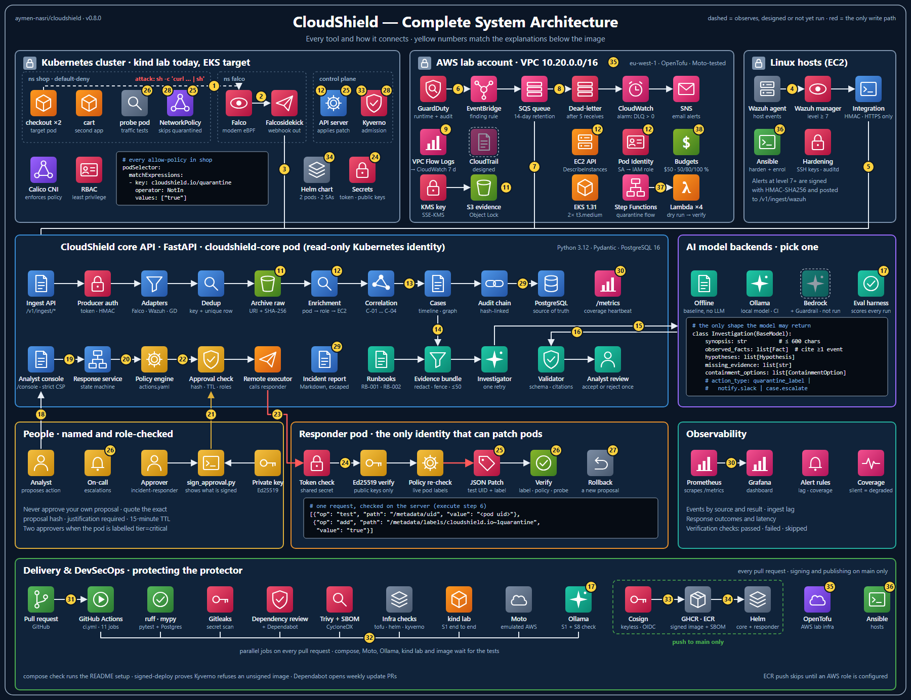
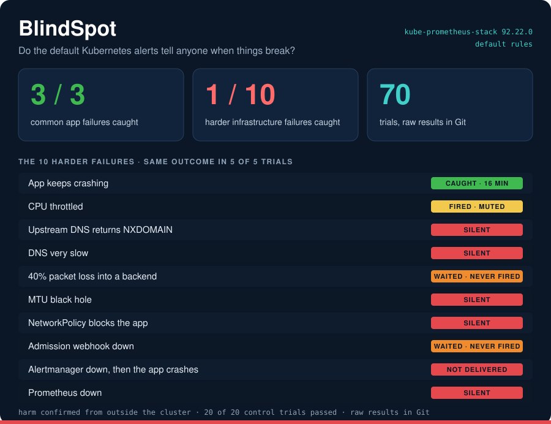

  

  
  
  
  

I'm a cybersecurity engineering student at **TEK-UP** in Tunis, graduating in 2027, focused on **cloud security, SOC automation and DevSecOps**. I like the part of security that is easy to get wrong when you automate it: turning scattered alerts into one clear story, and making sure no containment action can fire without a policy check and a human decision.

Everything I publish runs its own attack or failure in CI, and says plainly what works today and what doesn't yet.

**Open to** a 2027 end-of-studies (PFE) internship and junior roles in cloud security, SOC or DevSecOps, in Europe, remotely or in Tunisia.

## What I bring

| Area | What I work with |
|---|---|
| **Cloud security on AWS** · *AWS SAA* | GuardDuty, EventBridge, SQS, Lambda, CloudTrail, WAF, S3 Object Lock and KMS, least-privilege IAM, infrastructure as code |
| **Kubernetes** · *CKA* | RBAC, NetworkPolicy isolation, Kyverno admission control, Helm, Falco runtime detection, Prometheus and Alertmanager |
| **Detection and response** | Wazuh, Shuffle SOAR, pfSense, Suricata and Snort; automated playbooks with human-approved containment |
| **Linux and automation** · *RHCE · RHCSA* | Red Hat Enterprise Linux, system hardening, Ansible, Bash and Python |
| **Offensive security** · *eJPTv2* | Reconnaissance, vulnerability assessment and exploitation with Nmap, Metasploit and Hydra |

## Featured projects

<table>
<tr>
<td width="50%" valign="top">

<h3><a href="https://github.com/aymen-nasri/cloudshield">CloudShield</a></h3>
AI-assisted security operations with human-approved incident response. Falco, GuardDuty and Wazuh alerts become one evidence-backed case. An AI investigator with no credentials writes a cited summary. A pod is quarantined only after a policy check and a second person's signed approval, then verified with a real traffic probe.
  
A live attack runs against a Kubernetes cluster on every pull request.
  
<b>Python · FastAPI · PostgreSQL · Falco · Kyverno · Calico · Helm · OpenTofu · AWS · Cosign</b>
</td>
<td width="50%" valign="top">

<h3><a href="https://github.com/aymen-nasri/blindspot">BlindSpot</a></h3>
Breaks a test Kubernetes cluster in real ways and measures which failures the monitoring actually reports. The default kube-prometheus-stack alerts caught every common app failure, but only 1 of 10 harder infrastructure failures, such as DNS errors, an MTU black hole or Prometheus itself going down.
  
Results page: <a href="https://aymen-nasri.github.io/blindspot/">aymen-nasri.github.io/blindspot</a>
  
<b>Python · kind · kubeadm · Prometheus · Alertmanager · Helm · QEMU/KVM · Ansible · GitHub Actions</b>
</td>
</tr>
</table>

### More projects

| Project | What I built | Stack |
|---|---|---|
| **Autonomous cloud SOC and incident response** *(2025–2026)* | A security operations platform on AWS with OpenSearch as the log backend. Wazuh and Shuffle workflows isolate compromised EC2 instances, revoke suspicious IAM roles, block IPs at the WAF and take forensic EBS snapshots. VPC Flow Logs, CloudTrail and firewall telemetry land in one SIEM dashboard. | AWS · OpenSearch · Wazuh · Shuffle |
| **SOC automation lab** *(2025)* | A mini SOC with pfSense, Wazuh and Shuffle. My playbook checks an IP's reputation, blocks it through the pfSense API and alerts Slack, which cut alert handling for low and medium incidents from minutes to under 5 seconds. | pfSense · Wazuh · Shuffle · Slack API |
| **Secure biometric vault** *(2025)* | A desktop app with fingerprint authentication and AES-256 encrypted storage. LSB watermarks on fingerprint templates reveal and attribute database theft; simulated template-theft and replay attacks trigger lockout and alerts. | Python · AES-256 · SHA-256 · Tkinter |

## Certifications

  

## Tools I use

  

**Security:** Wazuh · Shuffle · pfSense · Falco · Kyverno · Suricata · Snort · Nmap · Metasploit · Hydra · Gitleaks · Trivy · Cosign 
**Infrastructure:** OpenTofu · Helm · kind · kubeadm · Calico · QEMU/KVM · cloud-init 
**Data and crypto:** OCSF · OpenSearch · SQL · AES-256 · SHA-256 · PKI

## How I work

- **Prove it.** Each project ships its own attack or failure scenario and runs it in CI, so the results are evidence, not claims.
- **Say what is real.** My READMEs mark every part as built, written as code, emulated or planned, and list known limits.
- **Make automation safe.** Least privilege, reversible actions, signed approvals and an audit trail come before speed.

## Right now

- Taking **CloudShield** from AWS emulators to a real lab account, the next milestone on its roadmap.
- Running **BlindSpot**'s node failures on real virtual machines, with results still coming in.

## Background

- **Education:** B.Eng. in Computer Science, Cybersecurity, at TEK-UP University of Digital Sciences, Tunis (2024–2027), after a preparatory cycle in Mathematics and Physics (2021–2024)
- **Community:** active member of **Securinets**, taking part in CTF competitions, workshops and knowledge-sharing sessions
- **Languages:** Arabic (native), English (fluent), French (fluent)

Thanks for stopping by. The fastest way to reach me is <a href="https://www.linkedin.com/in/aymen-nasri0">LinkedIn</a> or <a href="mailto:aymen.nasri.1336@gmail.com">email</a>.

